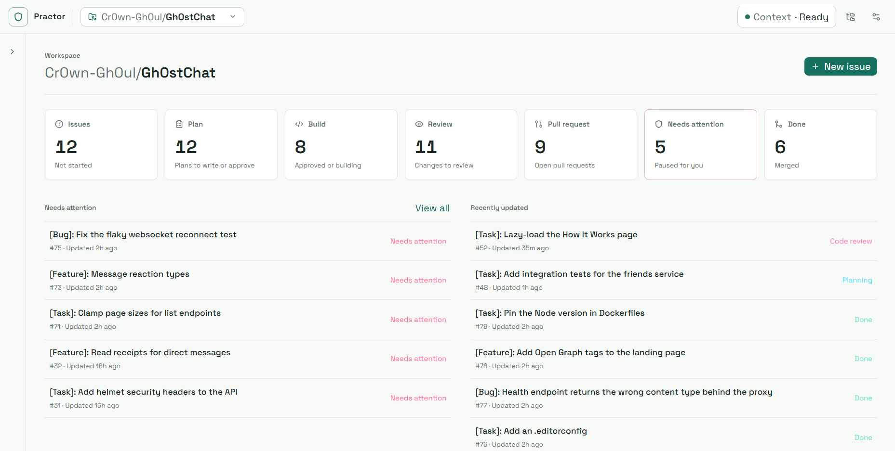
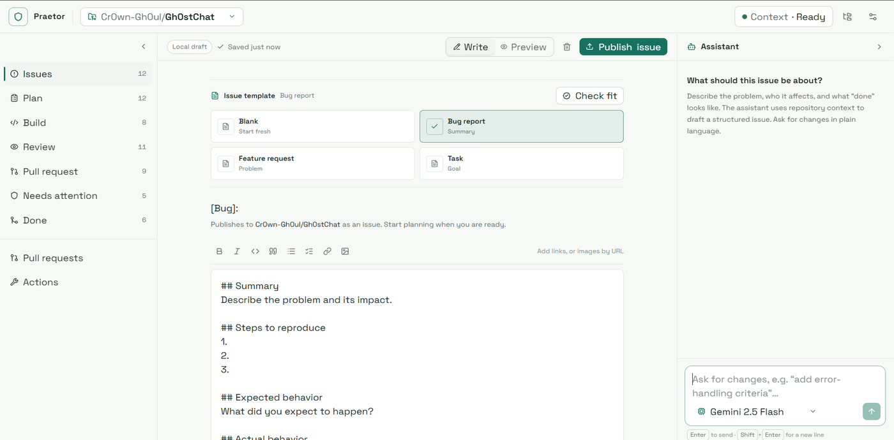
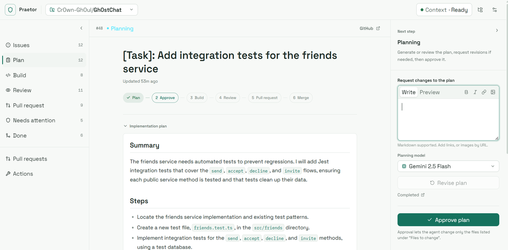
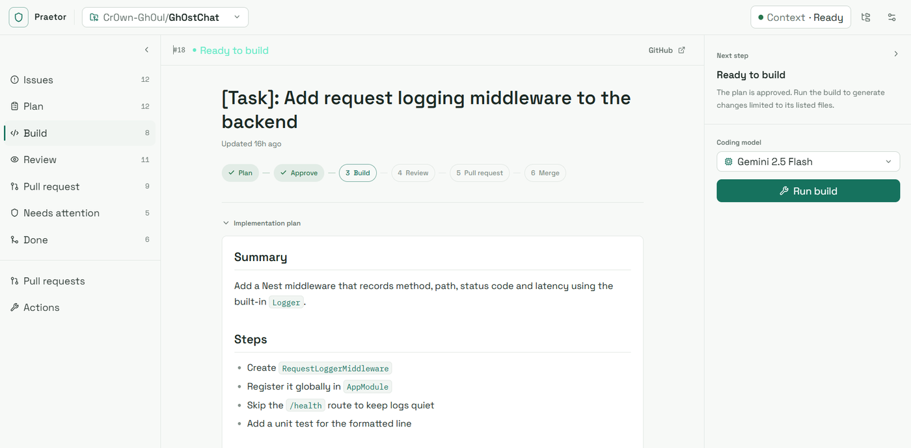
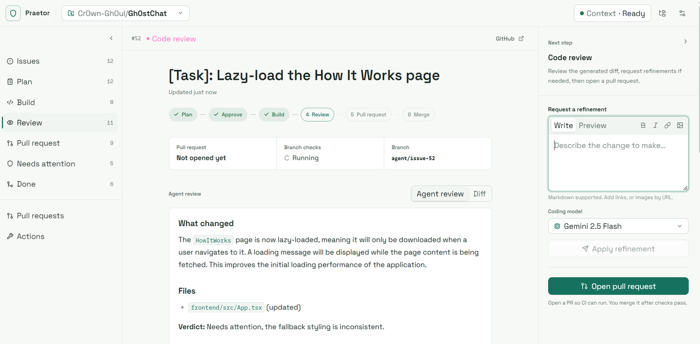
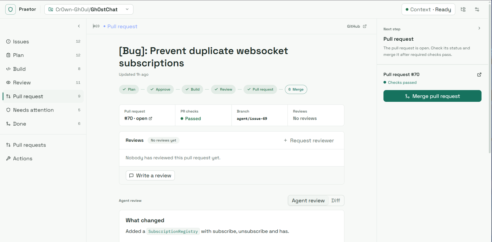
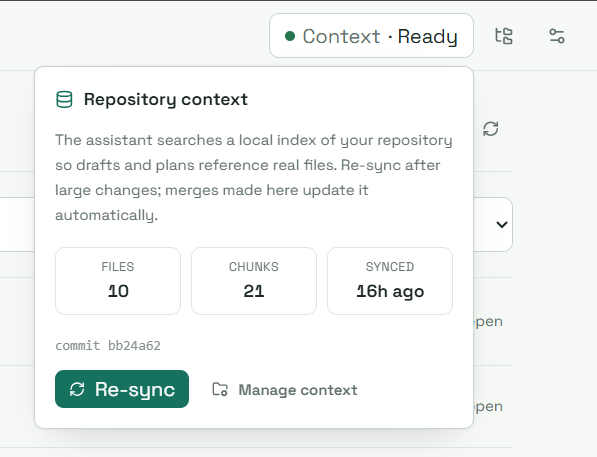

<div align="center">

# Praetor

**A control room for agent-driven development.**

Cloud agents run in your GitHub Actions to carry an issue from idea to pull request.<br>
Assistant agents help you steer every step. You approve, redirect, and merge.

[Features](#features) · [How it flows](#how-it-flows) · [Get started](#get-started) · [Context](#context)



</div>

## Features

| | |
| --- | --- |
| 🤖 **Cloud agents, full flow** | Planning, coding, refinements, and CI repair run as workflows in your own repository, using the OpenRouter models you pick for each stage. |
| 💬 **Assistants at every step** | Draft issues with repository-aware help, revise plans with feedback, and request refinements right on the diff. |
| 📚 **Obsidian and repo context** | Index your code, docs, and Obsidian notes (kept in a Git repo) so agents work from what you actually know. |
| 🔍 **Agent review and diff** | Every build gets an agent review. Switch between it and the diff, with checks and PR reviews alongside. |
| 🗂️ **One pipeline** | Issues, plans, builds, reviews, pull requests, and Actions in one view. Stuck work lands in *Needs attention*. |
| 🛡️ **Human approval gates** | You approve plans and their file scope, and you open and merge pull requests. |

## How it flows

<table>
  <tr>
    <td width="50%" valign="top">
      <h4>1 · Draft</h4>
      
      Draft an issue with an assistant and your GitHub templates.
    </td>
    <td width="50%" valign="top">
      <h4>2 · Plan</h4>
      
      An agent proposes steps and files to change. Revise it, then approve.
    </td>
  </tr>
  <tr>
    <td width="50%" valign="top">
      <h4>3 · Build</h4>
      
      Pick a model and a cloud agent implements the plan on a branch.
    </td>
    <td width="50%" valign="top">
      <h4>4 · Review</h4>
      
      Read the agent review, inspect the diff, and request refinements.
    </td>
  </tr>
  <tr>
    <td colspan="2" valign="top">
      <h4>5 · Ship</h4>
      
      Open the PR, gather reviews, and merge when checks pass. If CI fails, the agent gets up to three repair attempts before handing it back to you.
    </td>
  </tr>
</table>

<sub>Screenshots show a demo workspace.</sub>

## Get started

You'll need **Node.js 22**, a GitHub account with write access to your repository, and an **OpenRouter API key**.

```bash
npm ci
npm run dev
```

Open [localhost:3000](http://localhost:3000), connect GitHub and OpenRouter, and select a repository. In **Repository setup**, save the OpenRouter key as an Actions secret, review the workflow setup PR (including install and test commands), and merge it before running agents.

<details>
<summary><strong>GitHub connection and permissions</strong></summary>

<br>

GitHub App device sign-in is recommended. Register an app with **Device flow** and **User-to-server token expiration**, then set `GITHUB_APP_CLIENT_ID` and `GITHUB_APP_SLUG` in `.env.local` or your environment. No client secret or webhook is required.

Grant repository **read/write** access to Contents, Issues, Pull requests, Actions, Workflows, and Secrets, and **read** access to Metadata. Alternatively, use a fine-grained personal access token with the same permissions.

</details>

<details>
<summary><strong>Run with Docker Compose</strong></summary>

<br>

```bash
cp .env.example .env.local
docker compose -f .docker/docker-compose.yml up --build
```

The app binds to `127.0.0.1:3000` and uses the `agent-data` volume. Configure credentials in the browser or set `GITHUB_TOKEN`, `OPENROUTER_API_KEY`, `GITHUB_APP_CLIENT_ID`, and `GITHUB_APP_SLUG` in `.env.local`. Environment variables take precedence.

</details>

## Context

<table>
  <tr>
    <td valign="top">

Praetor keeps a local index of your repository so drafts and plans are grounded in real files.

**Bring your Obsidian notes too.** Commit your vault's Markdown notes to a GitHub repository you can read, then add their repo-relative paths to the target repository's `.github/agent-config.json`:

```json
{
  "contextSources": [
    { "repo": "owner/engineering-handbook", "paths": ["notes", "architecture"] },
    { "paths": ["docs/api"] }
  ]
}
```

Omit `repo` to use the active repository.

</td>
    <td width="24"></td>
    <td width="360" valign="top">
      
    </td>
  </tr>
</table>

Praetor indexes repository files; it does **not** connect to or sync an Obsidian vault directly. Context used in agent requests may be sent to the configured model provider.

## Good to know

- **Build states:** *Ready to build* means the plan is approved. *Build started* means the issue is marked as coding, not necessarily that a run is still active.
- **Safeguards:** Agents may only change files listed in the approved plan, and workflow files are rejected. These safeguards don't replace reviewing plans, diffs, checks, and permissions.
- **Local data:** Credentials, clones, drafts, and the index live in `.data/` by default. Protect it, or set `DATA_DIR` to move it. Local jobs don't resume after a server restart.

## Development

```bash
npm run typecheck
npm run lint
npm test
npm run build
```
