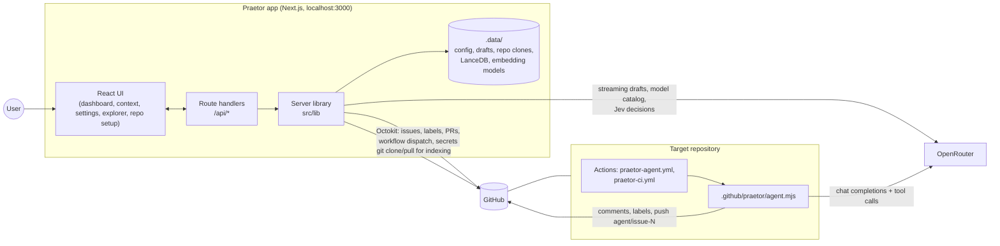
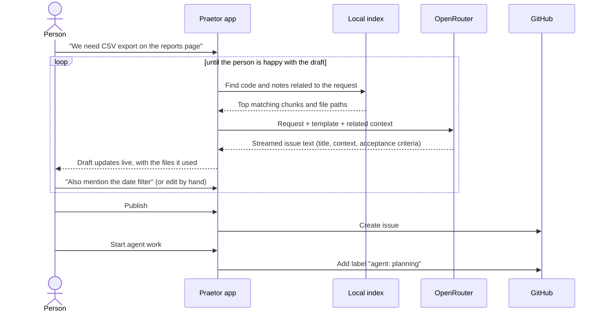
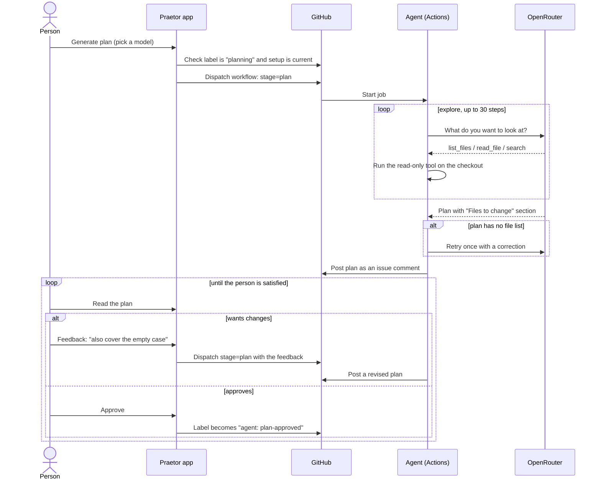
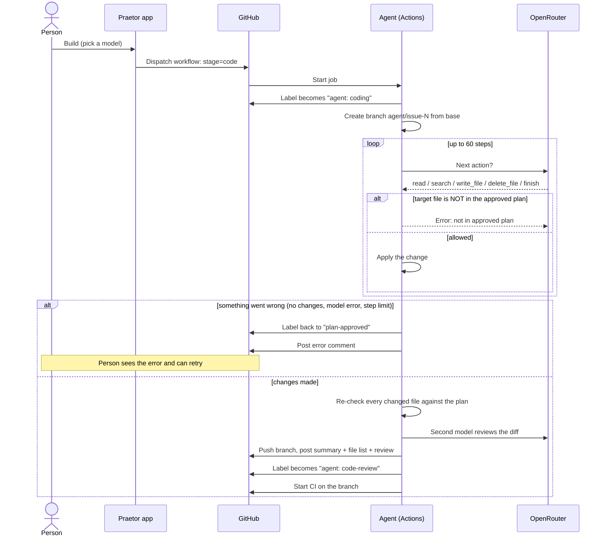
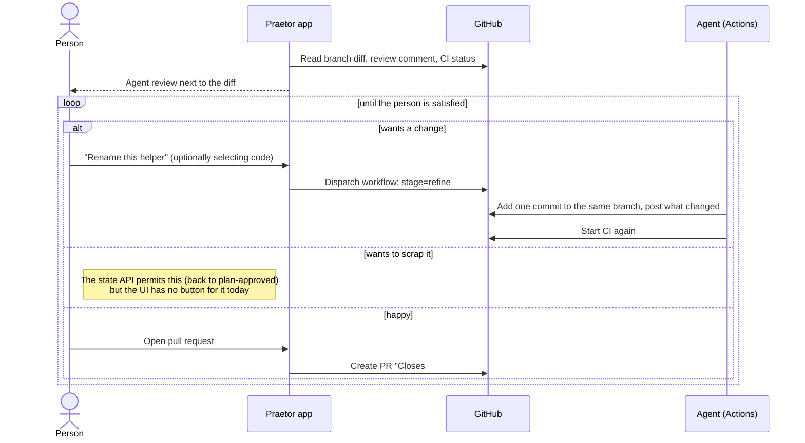
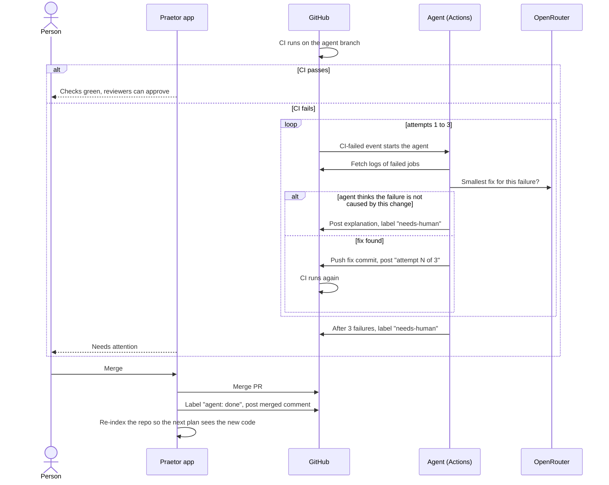
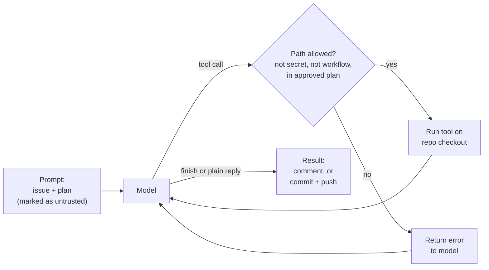

# Praetor: Specification, Architecture and Design

## Summary

Praetor takes a GitHub issue to a merged pull request with AI agents doing the work and a human approving each step. The key ideas, which are the parts worth copying:

1. **The agent runs in the team's own GitHub Actions**, not on a vendor's servers. Code and secrets stay inside GitHub. There is no hosted backend to run.
2. **GitHub is the database.** Pipeline state is one label on the issue (`agent: planning`, `agent: coding`, and so on). Plans, reviews and errors are issue comments. A small control app only reads and writes those.
3. **Humans hold every gate.** The agent proposes a plan, and a person approves it. The agent may then change *only the files that plan lists*. A person opens the PR and merges it. The one automatic step is fixing failing CI, limited to three tries.
4. **The agent is small and locked down.** It is one dependency-free file with a handful of tools (list, read, search, write, delete, finish) and no shell. It cannot touch workflows, secrets or files outside the approved plan.
5. **Context comes from a local index** of the repository and any extra notes repos, so drafts and plans refer to real files.

The rest of this document explains the state model (section 5), how a request flows through the system (sections 5.3 and 5.4), how the agent is contained (section 9), and what it would take to build something similar (section 14).

## 1. Purpose and scope

Praetor is a local web control room for agent-driven development. A person drives a GitHub issue through a fixed pipeline (draft, plan, build, review, pull request, merge). LLM agents do the heavy work inside the target repository's own GitHub Actions. The person approves every stage.

**Goals**

- Carry an issue from idea to merged PR with a human approval gate at each stage.
- Run code-writing agents in the user's GitHub Actions, with the user's OpenRouter key stored as an Actions secret, not on a Praetor server.
- Ground drafts and plans in repository context (code, docs, and Obsidian notes kept in a Git repo) through a local vector index.
- Keep all pipeline state in GitHub (labels and marker comments) so the app is stateless with respect to issues.

**Non-goals**

- Multi-user hosting, accounts, or RBAC. It is a single-user app that binds to `127.0.0.1`.
- Direct Obsidian vault sync. Notes are indexed only when they are committed to a GitHub repo.
- Running agents locally. The agent runtime executes only in GitHub Actions.
- Resuming local jobs after a server restart.

## 2. System context



There are two execution environments with a strict split of responsibilities:

| Environment | Responsibilities | Holds secrets |
| --- | --- | --- |
| **Praetor app** (local or Docker) | UI, GitHub orchestration, issue drafting assistant, local context index, repository setup PRs | GitHub token, OpenRouter key (in `.data/config.json`, mode 0600) |
| **Agent runtime** (GitHub Actions) | Planning, coding, refinement, self-review, CI repair, post-merge bookkeeping | `OPENROUTER_API_KEY` Actions secret, ephemeral `GITHUB_TOKEN` |

## 3. Technology stack

- Next.js 15 (App Router, `output: "standalone"`), React 19, Tailwind CSS 4, SWR for client polling, Monaco editor for files and diffs, `react-markdown` with `remark-gfm`.
- Node.js 22, TypeScript 5.9, Zod 4 for validation, Vitest for tests, ESLint.
- GitHub: `@octokit/rest`, `simple-git` (local clones), GitHub App device flow or fine-grained PAT, `libsodium-wrappers` (encrypt Actions secrets).
- LLMs: Vercel AI SDK (`ai`) with `@openrouter/ai-sdk-provider` for streamed drafting. Raw `fetch` against OpenRouter chat completions inside the agent runtime (it has no dependencies).
- Retrieval: LanceDB (`@lancedb/lancedb`), `@huggingface/transformers` embeddings (`Xenova/all-MiniLM-L6-v2`, 384 dimensions), `ts-morph` for TypeScript/JavaScript chunking.

Native or heavy packages are listed in `serverExternalPackages` in [next.config.ts](../next.config.ts). The agent runtime file is added to the standalone trace so it can be read from disk at runtime.

## 4. Source layout

```
src/
  app/                    Pages and route handlers
    api/                  REST endpoints (section 8)
    dashboard/            Main shell: home, issues, pulls, actions views
    context/ explorer/ onboarding/ repo-setup/ settings/
  components/             UI (drafts, issue actions, editor, markdown, pickers)
  hooks/                  SWR data hooks (polling intervals 1.5s to 10s)
  lib/
    config.ts             Settings store (file + env override)
    github.ts             All Octokit operations for the target repo
    github-auth.ts        Device-flow sign-in and token refresh
    state.ts              Pipeline state machine and label helpers
    bootstrap.ts          Generators for managed repo files
    repo-setup.ts         Setup status detection and command inference
    repo.ts               Local git clones used for indexing
    drafts.ts             File-backed issue drafts
    jobs.ts               In-memory per-repo job queue
    indexer/              Chunking, embedding, indexing
    lancedb.ts            Vector store wrapper
    agent/                Drafting prompts, retrieval context, streaming
    jev.ts                Template-fit scoring via OpenRouter decisions API
  agent-runtime/
    (one .mjs file)       Dependency-free agent program committed into target repos
.docker/                  Dockerfile and compose file
```

## 5. Pipeline and state model

### 5.1 States

Pipeline state is stored on the GitHub issue as exactly one label of the form `agent: <state>`. States and their label metadata live in [constants.ts](../src/lib/constants.ts).

| State | Meaning |
| --- | --- |
| `planning` | A plan is being generated or revised |
| `plan-approved` | Plan approved; ready to build |
| `coding` | The agent is generating changes |
| `code-review` | Changes are on branch `agent/issue-N`; ready for review |
| `pr-created` | A pull request is open |
| `needs-human` | Automation paused (build failed, CI repair exhausted, no-op fix) |
| `done` | PR merged |

An issue with no `agent:` label is untracked. If an issue ever carries zero or several agent labels, `stateFromLabels` returns `null`.

### 5.2 The state model at a glance

The normal path is a straight line. Thick arrows are steps a **person** takes. Dotted arrows are steps the **agent** takes on its own.

```mermaid
flowchart LR
    start(["New issue<br/>(no label)"])
    planning["<b>planning</b><br/>Plan is written or revised"]
    approved["<b>plan-approved</b><br/>Scope is locked"]
    coding["<b>coding</b><br/>Agent is writing code"]
    review["<b>code-review</b><br/>Branch is ready to inspect"]
    pr["<b>pr-created</b><br/>PR open, checks running"]
    done(["<b>done</b><br/>Merged"])

    start == "person starts work" ==> planning
    planning == "person approves plan" ==> approved
    approved == "person clicks Build" ==> coding
    coding -. "agent pushes branch" .-> review
    review == "person opens PR" ==> pr
    pr == "person merges" ==> done

    classDef person fill:#e8f0fe,stroke:#4a6fd8,color:#111
    classDef agent fill:#fdeaf4,stroke:#c2478c,color:#111
    classDef end_ fill:#e6f7ee,stroke:#2e9e6a,color:#111
    class planning,approved,review,pr person
    class coding agent
    class start,done end_
```



Blue states are waiting for a person. The pink state is the only one where the agent is working and nobody needs to act. So at any moment the label tells you whose turn it is.

**Where things go off the main path.** These are the only other moves, kept out of the diagram so the main line stays readable.

| Situation | From | To | Who or what causes it |
| --- | --- | --- | --- |
| Reviewer wants a different plan after approving | `plan-approved` | `planning` | Allowed by the state API; no UI button today. Feedback is normally given while still in `planning`. |
| Build crashed or produced nothing | `coding` | `plan-approved` | Agent rolls the label back and posts an error comment, so the person can just retry |
| Reviewer rejects the generated code | `code-review` | `plan-approved` | Allowed by the state API; no UI button today. Refinement is the normal route. |
| CI keeps failing, or the agent decides the failure is not its change | `code-review` or `pr-created` | `needs-human` | Agent, after 3 repair attempts or a no-op fix |
| Person has taken over and wants to resume | `needs-human` | any earlier state | Person picks where to restart |

**Loops that do not change state.** Several things repeat without moving the label:

- Revising the plan (`planning` stays `planning`; a new plan comment is posted).
- Refinement requests during review (`code-review` stays `code-review`; each adds one commit to the branch).
- CI repair (`code-review` or `pr-created` stays put until the third failed attempt).

**Enforcement.** `ALLOWED_TRANSITIONS` in [state.ts](../src/lib/state.ts) lists every legal move. `POST /api/issues/[number]/state` rejects anything else with a 409, and an untracked issue may only move to `planning`. The agent writes some labels itself (`coding`, `code-review`, the rollback to `plan-approved`, `needs-human`, `done`). It does not use that table; instead it checks the current label before each stage and refuses to run from the wrong one.

### 5.3 Marker comments

Agent output is stored as issue comments that begin with an HTML marker. The latest comment with a marker is authoritative.

| Marker | Content |
| --- | --- |
| `<!-- agent:plan -->` | Latest implementation plan |
| `<!-- agent:self-review -->` | Change summary, file list, agent review |
| `<!-- agent:refine -->` | A refinement request and result |
| `<!-- agent:ci-fix:<runId> -->` | One CI repair attempt (also dedupes per failed run) |
| `<!-- agent:ci-fix-limit -->` | Hand-off after the repair limit |
| `<!-- agent:merged -->` | Issue finalized after merge |
| `<!-- agent:error -->` | Agent failure, shown as `latestAgentError` |
| `<!-- agent:meta {json} -->` | Trailing metadata (models used, run URL); stripped for display |

The marker strings are duplicated in the app ([constants.ts](../src/lib/constants.ts)) and the agent runtime ([source](../src/agent-runtime/codeless-agent.mjs)). Keep them in sync.

### 5.4 How a request flows through the system

The flow is shown one phase at a time so the loops and failure paths are visible. In every diagram, the **Praetor app** is the local control room, **GitHub** holds all state, and the **Agent** is the job running in GitHub Actions. A person never talks to the agent directly. They change GitHub, and the agent reacts to GitHub.

#### Phase 1: Draft the issue

The assistant runs inside the app, not in Actions, because it is only chatting and editing text.



#### Phase 2: Plan, with human approval



The file list in the approved plan becomes the agent's write allowlist in the next phase.

#### Phase 3: Build, with rollback if it fails



#### Phase 4: Review and refine



#### Phase 5: Checks, automatic repair, merge

This is the only part of the system that acts without a person asking.



If the PR is merged on GitHub instead of through the app, a workflow triggered by the merge sets `done` itself, so state stays correct either way.

#### Inside one agent step

Every agent stage uses the same small loop. This is the core of the "agent":




## 6. Components

### 6.1 Agent runtime ([source](../src/agent-runtime/codeless-agent.mjs))

A single dependency-free ES module (about 800 lines) that setup PRs commit to `.github/praetor/agent.mjs`. It is invoked as `node .github/praetor/agent.mjs run` and is configured through `PRAETOR_*` environment variables (`STAGE`, `ISSUE`, `MODEL`, `REVIEW_MODEL`, `INSTRUCTION`, `SELECTED_CODE`, `CI_RUN_ID`, `PR_BRANCH`).

Stages:

| Stage | Trigger | Preconditions | Result |
| --- | --- | --- | --- |
| `plan` | `workflow_dispatch` | state `planning` | Read-only tool loop (max 30 steps) produces a Markdown plan. The plan must contain a `Files to change` section, with one retry if it does not. Posts `agent:plan`. |
| `code` | `workflow_dispatch` | state `plan-approved` | Sets `coding`. Checks out `agent/issue-N` from the base branch. Tool loop (max 60 steps) writes files. Self-review model reviews the diff. Force-pushes, posts `agent:self-review`, sets `code-review`, dispatches CI. On any error, rolls back to `plan-approved`. |
| `refine` | `workflow_dispatch` | state `code-review` or `pr-created` | Applies a reviewer's instruction (optionally with selected code) as a new commit (non-force push). |
| `ci-fix` | `workflow_run` of "Praetor CI" with failure on an `agent/issue-*` branch | state `code-review` or `pr-created` | Fetches failed job logs, attempts the smallest fix. After `MAX_CI_FIX_ATTEMPTS = 3` or a no-change result, sets `needs-human`. Idempotent per run ID. |
| `merged` | `pull_request` closed and merged on an `agent/issue-*` branch | none | Sets `done` and posts `agent:merged` (skipped if already present). |

Tool surface for the model:

- Read tools: `list_files`, `read_file` (line ranges), `search` (`git grep`).
- Write tools: `write_file` (complete contents), `delete_file`, `finish(summary)`.
- No shell access. CI runs tests after the push.

Model client: OpenRouter `/chat/completions` with `tool_choice: auto`, temperature 0.2, 5 minute timeout, and up to four attempts with exponential backoff on 429, 5xx, and network errors. Failures map to actionable messages (invalid key, no credits, model unavailable).

On failure the runtime posts an `agent:error` comment, writes a step summary, and exits non-zero.

### 6.2 Praetor app, server side

**Configuration** ([config.ts](../src/lib/config.ts)). Settings are stored in `<DATA_DIR>/config.json` (default `./.data`, or `/data` when `DOCKER=1`), written atomically with mode 0600. Environment variables `GITHUB_TOKEN`, `OPENROUTER_API_KEY`, and `BASE_BRANCH` override saved values. Changing the target repository clears `additionalContextPaths`. `getPublicConfig` masks secrets for the browser. The app counts as configured when it has a GitHub credential and an OpenRouter key; otherwise `/` redirects to `/onboarding`.

**GitHub auth** ([github-auth.ts](../src/lib/github-auth.ts)). Preferred sign-in is the GitHub App device flow using only a public client ID (`GITHUB_APP_CLIENT_ID`, `GITHUB_APP_SLUG`). User tokens expire, so `getGitHubToken` refreshes them five minutes early, sharing one in-flight refresh. A fine-grained PAT is the fallback. Required permissions: read/write on Contents, Issues, Pull requests, Actions, Workflows, Secrets; read on Metadata.

**GitHub operations** ([github.ts](../src/lib/github.ts)). One module wraps Octokit for the configured `owner/repo`: repository listing (write access only), issues and labels, PRs and reviews, CI status, workflow dispatch and run listing, repository secrets (libsodium sealed box), branch compare for diffs, and a tree/commit helper used for setup PRs. CI status is derived from Actions workflow runs (`ciStatusFromRuns`), excluding the agent workflow, because the Checks API is not readable with all token types.

**Repository setup** ([bootstrap.ts](../src/lib/bootstrap.ts), [repo-setup.ts](../src/lib/repo-setup.ts)). The app installs four managed files into the target repo through a reviewed PR from a dedicated setup branch:

| File | Purpose |
| --- | --- |
| `.github/agent-config.json` | `include`/`exclude` for indexing, install and test commands, Node version, base branch, `contextSources` |
| `.github/workflows/praetor-agent.yml` | Agent workflow (dispatch, CI-failure, and merge triggers) |
| `.github/workflows/praetor-ci.yml` | Install and test on pull requests and dispatch |
| `.github/praetor/agent.mjs` | The agent runtime |

Workflow, CI, and runtime files carry a stamp: `# praetor-managed: v<N>` and a `praetor-hash`. The app compares them to `SETUP_VERSIONS` and reports each file as `current`, `missing`, `outdated`, `modified` (hash mismatch, so edited by hand), or `invalid`. Setup is "ready" only when no file is missing or invalid, the `OPENROUTER_API_KEY` secret exists, and nothing is outdated. Plan, code, and refine endpoints refuse to dispatch unless setup is ready. Bump the version in `SETUP_VERSIONS` whenever generated content changes. Install and test commands are inferred from `package.json` files when no config exists, and validated to a single line of at most 300 characters. Starter issue templates are added when missing, and legacy bootstrap files are deleted.

**Drafting assistant** ([agent/](../src/lib/agent), [api/agent/draft](../src/app/api/agent/draft/route.ts)).
1. Validate the request (Zod, `strict()`), load the file-backed draft.
2. Optionally attach up to 8 user-selected files, accepted only if they appear in the index and are not sensitive paths.
3. Optionally retrieve context: embed the query, search the target repo and every configured context source, take the top 8 chunks, cap at 24,000 characters.
4. Stream the model output as plain text. Response headers report `X-Context-Status`, `X-Context-Sources`, and `X-Model`. Failures before the first token become JSON errors. On completion the revision is saved to the draft (title, body, last 60 messages).

Untrusted content (draft text, retrieved context, files) is wrapped in `<untrusted-data>` blocks and the system prompt tells the model not to follow instructions inside them.

**Template fit** ([jev.ts](../src/lib/jev.ts)). `POST /api/agent/decisions` calls OpenRouter's alpha decisions API (model `typesafe/jev-1.13`) to score how well a draft completes the selected issue template. It has an 8 second timeout.

**Drafts** ([drafts.ts](../src/lib/drafts.ts)). One JSON file per draft in `<DATA_DIR>/drafts`, written atomically. Publishing creates the GitHub issue and deletes the draft.

**Context indexing** ([indexer/](../src/lib/indexer), [lancedb.ts](../src/lib/lancedb.ts), [repo.ts](../src/lib/repo.ts)).

- Repositories are cloned to `<DATA_DIR>/repos/<owner>__<repo>` using a short-lived `GIT_ASKPASS` script that supplies the token. Token text is redacted from errors.
- Files to index = `include` paths from `agent-config.json` merged with user-added context paths, minus `exclude`, plus each `contextSources` entry (which can name other repositories, for example an Obsidian vault repo).
- Chunking: TypeScript/JavaScript is split by `ts-morph` into functions, classes (or members when large), interfaces, types, enums, and exported consts, plus a "file overview" chunk. Markdown and plain text use their own chunkers.
- Embedding: local MiniLM model, batches of 32, model cached in `<DATA_DIR>/models`.
- Storage: one LanceDB table per repo key. Upsert is delete-by-path then append.
- Metadata (`index-meta.json`): commit, file list, chunk counts per file.
- `fullIndex` rebuilds everything. `incrementalIndex` re-embeds only files changed since the indexed commit, and falls back to a full index when context sources are configured or no prior metadata exists.
- Sensitive paths (`.env`, keys, credentials, and so on) are excluded from context and attachments.

**Jobs** ([jobs.ts](../src/lib/jobs.ts)). A small in-memory queue keyed by repo. One job per repo runs at a time, and duplicate requests for the same kind return the existing job. Clients poll `GET /api/index-repo?jobId=`. Jobs are lost on restart.

**Post-merge** ([post-merge.ts](../src/lib/post-merge.ts)). After the app merges a PR it sets `done`, queues an incremental reindex, and posts `agent:merged`. It is idempotent through the marker.

### 6.3 Frontend

The home route redirects to `/dashboard` when configured and to `/onboarding` otherwise. Pages:

| Route | Purpose |
| --- | --- |
| `/dashboard` | Shell with views for home (stage counts, needs attention, activity), issues, pulls, and actions. Deep-linkable through `?issue=`, `?draft=`, `?view=`, `?stage=`. |
| `/context` | Index status, sync, context paths |
| `/explorer` | Browse and preview repository files |
| `/repo-setup` | Setup status, settings, secret storage, setup PR |
| `/settings` | Credentials, models per stage, repository |
| `/onboarding` | First-run wizard |

Stage-specific controls live in `components/issue/` (`PlanActions`, `CodeReviewActions`, `PullRequestControls`, `PullRequestReviews`). Data is fetched with SWR hooks that poll (issue 10s, agent runs 5s, index job 1.5s) because there is no push channel. Model choices per stage are remembered in browser storage and default to the configured models. Defaults (`DEFAULT_MODELS`): drafting and planning `google/gemini-2.5-flash`, coding and review `~anthropic/claude-sonnet-latest`.

## 7. Data model

**Local (`DATA_DIR`, default `.data/`, gitignored)**

| Path | Content |
| --- | --- |
| `config.json` | `AppConfig`: tokens, OpenRouter key, target repo, base branch, extra context paths, per-stage models |
| `drafts/<uuid>.json` | `DraftIssue` with message history |
| `repos/<owner>__<repo>/` | Git clones used for indexing |
| `lancedb/` | Vector tables, one per repo |
| `index-meta.json` | Per-repo index metadata |
| `models/` | Embedding model cache |

**GitHub (source of truth for pipeline state)**: labels (`agent: *`), issue comments with markers, branch `agent/issue-N`, PRs, workflow runs, and the `OPENROUTER_API_KEY` Actions secret.

Key types are in [types.ts](../src/lib/types.ts), with runtime validation in [schemas.ts](../src/lib/schemas.ts).

## 8. HTTP API

The browser talks to about 40 small route handlers under `src/app/api/`, grouped as config and sign-in, repository files and setup, context indexing, drafts, agent dispatch (`/api/agent/plan`, `/code`, `/refine`), and issue actions (state, diff, PR, merge, reviews). They are thin: each one validates its input with a strict Zod schema, checks that the issue is in the right state (returning 409 if not), and calls a function in `src/lib`. Errors always have the shape `{ error: { code, message } }`. The route files are the reference.

The agent endpoints are worth knowing: they do not run the agent. They check preconditions and then trigger a GitHub Actions `workflow_dispatch` and return `202 Accepted`. The UI then polls GitHub for the run and the resulting comment.

## 9. Security design

**Trust boundaries.** Issue text, comments, repository files, CI logs, and retrieved context are untrusted. They are wrapped in `<untrusted-data>` blocks and both system prompts instruct the model to ignore instructions inside them.

**Human gates.** Plans are approved by a person. The build is dispatched by a person. PR creation and merge are person actions. The only automatic stage is CI repair, capped at 3 attempts.

**Write scope in the runtime** (`checkWritablePath`, `verifyChangedPaths`):
- Only paths listed under `Files to change` in the latest plan may be written or deleted. The staged diff is re-checked before commit.
- `.github/workflows` and the agent's own directory are never writable by the agent. They change only through a Praetor setup PR.
- `node_modules`, `.git`, absolute paths, and `..` segments are rejected. Symlinks and paths that resolve outside the repo are blocked.
- Secret-looking files (`.env*`, `.npmrc`, `.netrc`, SSH keys, `*.pem`, `*.key`, credentials) can be neither read nor written, and are filtered from `list_files` and `search` output.

**Credentials.**
- `config.json` is created with directory mode 0700 and file mode 0600. The browser only sees a masked OpenRouter key.
- The OpenRouter key reaches the agent only as an Actions secret (encrypted with libsodium before upload).
- Git operations use `GIT_ASKPASS`, not tokens in URLs, and errors redact tokens.
- The agent pushes with the workflow's `GITHUB_TOKEN`, scoped to the repo, through an HTTP extra-header.

**Workflow hardening.** The generated agent workflow only runs `workflow_run` and `pull_request` jobs for `agent/issue-*` branches from the same repository, checks out the default branch with `persist-credentials: false`, serializes runs per issue through a concurrency group, and has a 45 minute timeout.

**Network exposure.** Docker Compose binds to `127.0.0.1:3000`. The API has no authentication of its own, so anyone who can reach the port can act with the stored GitHub credentials.

**Data sent out.** Retrieved context and attached files are sent to the configured model provider. This is called out in the README.

## 10. Deployment

- **Local**: `npm ci && npm run dev`. Requires Node 22, `git`, and network access for the first embedding model download.
- **Docker**: multi-stage build ([.docker/Dockerfile](../.docker/Dockerfile)) producing a standalone Next.js server on `node:22-bookworm-slim` with `git` installed, running as user `node`. `DATA_DIR=/data` and `HF_HOME=/data/models` point at a named volume (`agent-data`). Credentials can be supplied through `.env.local`.
- **Environment variables**: `GITHUB_APP_CLIENT_ID`, `GITHUB_APP_SLUG`, `GITHUB_TOKEN`, `OPENROUTER_API_KEY`, `BASE_BRANCH`, `DATA_DIR`, `DOCKER`.

## 11. Testing and quality

Vitest unit tests sit next to the code (`*.test.ts`) and cover the pure logic: state machine, config store, bootstrap generators and drift detection, chunking and selection, embedding validation, vector store, CI status, reviews, issue templates and stages, job queue, GitHub auth, prompts, and the agent runtime. Scripts: `npm run typecheck`, `npm run lint`, `npm test`, `npm run build`. There are no end-to-end tests and no CI workflow in this repository (`.github/` is empty).

## 12. Design decisions and trade-offs

| Decision | Rationale | Cost |
| --- | --- | --- |
| Pipeline state in labels and comments | No database; state survives app restarts; visible to the whole team on GitHub | Rate limits and latency, polling for freshness, label edits by others can desync state |
| Agents run in the target repo's Actions | Compute and secrets stay with the user; auditable runs; no hosted backend | Needs setup PR, Actions minutes, and `workflow_dispatch` permissions |
| Dependency-free single-file runtime, copied into each repo | No install step in the agent job; fast start | Version drift across repos (mitigated by the managed-file stamp and `outdated` status); marker and helper logic is duplicated between app and runtime |
| Plan's `Files to change` section is the write allowlist | Simple and reviewable scope control | Plans must stick to the expected Markdown shape (the runtime retries once and then fails) |
| Local embeddings plus LanceDB | No extra service; code does not leave the machine for indexing | Large first-run model download and CPU cost; the full index reruns when context sources exist |
| In-memory job queue | Simplicity | Jobs do not survive restart |
| Polling over push | No webhook endpoint or public URL needed (the device flow also needs no secret or webhook) | Up to 10 second staleness in the UI |

## 13. Known gaps and follow-ups

These are observations from reading the code, not committed plans.

- **No API authentication.** Fine for the documented `127.0.0.1` binding. Exposing the port, or running behind a proxy, needs an auth layer.
- **Duplicated safety logic.** `extractPlannedPaths` and sensitive-path rules exist in both [code-safety.ts](../src/lib/agent/code-safety.ts) and the runtime. `validateGeneratedChanges` in the app has no non-test callers, since the runtime now enforces the same rules.
- **Approval is implicit.** Plan approval is a label change. The record of who approved what is only the GitHub issue timeline.
- **Dispatch feedback.** There is no pre-flight check that a dispatched workflow started. The UI infers it from the run list with a two-minute grace period.
- **Concurrency.** Config and metadata files use atomic rename but no locking between concurrent requests.

## 14. Building something similar

Size of this implementation for scale: about 9,400 lines of source (UI included) plus about 1,500 lines of tests. The agent itself is one file of roughly 800 lines. The parts that make the system trustworthy are small. Most of the code is the control-room UI and the context index, which are useful but not required to start.

### What each piece is for

| Piece | Role | Needed for a first version? |
| --- | --- | --- |
| Label-based state machine ([state.ts](../src/lib/state.ts), about 40 lines) | Defines whose turn it is and which moves are legal | Yes |
| Agent runtime (one file) | Plan, code, refine, CI repair, merge bookkeeping, with the write allowlist | Yes |
| Agent workflow + CI workflow | Run the agent in Actions on dispatch, on CI failure, and on merge | Yes |
| Marker comments | Store plans, reviews and errors on the issue | Yes |
| Approval gates | A person moves the label to approve a plan and opens and merges the PR | Yes |
| Setup PR with version stamps | Installs the agent into a repo and detects drift | Not at first; copy the files by hand for one repo |
| Control-room web app | Friendly UI, diff view, model picker, status | No. GitHub's own issue, Actions and PR pages can serve as the UI |
| Draft assistant | Helps write good issues | No |
| Local context index (LanceDB, embeddings) | Grounds drafts and plans in repo and notes | No. The agent can already read the repo with its search and read tools |

A reasonable first build is therefore: the state labels, the agent file, the two workflows, and the rules in section 9. A person would start stages from the Actions tab (`workflow_dispatch`) and read plans and reviews as issue comments. The web app, assistant and index can be added later if the workflow proves useful.

### Design rules worth keeping

1. **Make the label the single source of truth for whose turn it is**, and have every stage refuse to run from the wrong state.
2. **Approve scope, not just intent.** The plan's file list is machine-read and becomes the only set of files the agent may write. It is checked again on the staged diff before pushing.
3. **No shell for the agent.** Reading, searching, writing and deleting are enough, and CI runs the tests. This removes a whole class of risk.
4. **Protect the pipeline itself.** The agent can never edit workflow files, its own program, or anything that looks like a secret. Those change only through a reviewed human PR.
5. **Treat all text as untrusted.** Issue bodies, files and CI logs are wrapped and labelled as data in every prompt.
6. **Bound everything.** Step limits per stage, a three-attempt cap on repairs, one workflow run per issue at a time, and idempotency markers so a retried event does not repeat work.
7. **Fail back to a safe state with a visible message.** A failed build returns the issue to `plan-approved` and posts an error comment, so nobody has to guess.

### Decisions for your team

| Decision | Options and what this implementation chose |
| --- | --- |
| Where the agent runs | GitHub Actions in each repo (chosen) versus a central service. Actions keeps code and secrets in GitHub but spends Actions minutes. |
| Model provider | OpenRouter (chosen) gives one key and many models, and each stage can use a different model. A direct provider or an internal gateway is a small change in one function in the agent and one in the app. |
| Who can start work | Anyone who can dispatch workflows or edit labels on the repo. Review who has that permission. |
| Credentials | A GitHub App with device-flow sign-in (chosen) versus a personal token. A per-repo Actions secret holds the model key. |
| Cost control | There is no built-in budget. Step limits and model choice bound cost per run, but a spend cap would need to be added at the provider. |
| Review burden | Humans still review plan, diff and PR. The agent review is an extra opinion, not a replacement. |

### Risks to raise

- Agent output is only as safe as the allowlist and review. The write controls reduce risk but do not replace reading the diff.
- Plans and code are sent to the model provider. Decide what repositories are allowed to do that.
- State lives in labels and comments, so anyone with write access can move an issue between states by hand. The state API rejects illegal moves, but GitHub itself does not.
- The agent file is copied into each repo, so upgrades need a rollout process. This implementation detects out-of-date copies and offers an update PR.
